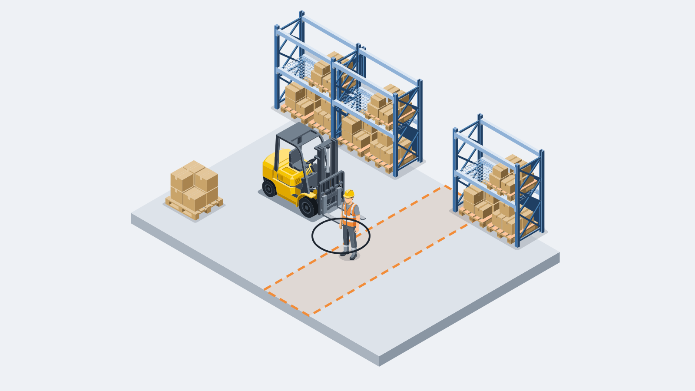
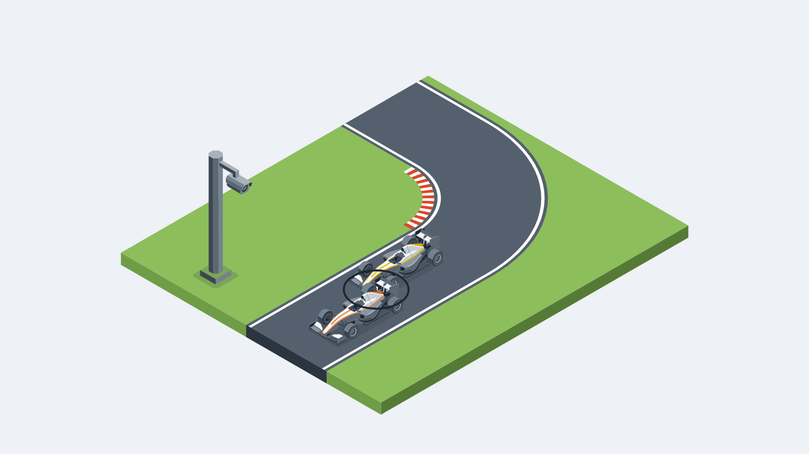

# faultline

[](LICENSE)
[](pyproject.toml)
[](packs/README.md)
[](experiments/README.md)

faultline is a rules-compliance judge for video.
Give it a rules pack and footage, and it says for each rule whether it was followed and who broke it.
Every output is a ruling: the rule, the offender and the evidence, never tips or statistics.
It covers two domains today: warehouse forklifts, under OSHA 29 CFR 1910.178 and each site's own rules, and sim-racing leagues on PitBot (pitbot.gg), Brock's league management platform.

<table>
<tr>
<td width="50%" valign="top">

<br>
A forklift's forks reach a worker at the edge of a walkway
</td>
<td width="50%" valign="top">

<br>
The car behind runs into the car ahead on the exit of a corner
</td>
</tr>
</table>

**Contents:**
[Built during the hackathon, and what existed before](#built-during-the-hackathon-and-what-existed-before) ·
[How it works](#how-it-works) ·
[What was measured](#what-was-measured) ·
[Meta models used so far](#meta-models-used-so-far) ·
[How to run](#how-to-run) ·
[Repo map](#repo-map) ·
[Licence](#licence) ·
[Provenance](#provenance)

---

## Built during the hackathon, and what existed before

### Built during the hackathon

- This repo.
- The provenance hook (`.githooks/commit-msg`), its installer, and the history check (`scripts/check_provenance.py`).
- The loader in this repo (`src/faultline/pack.py`), rewritten from a written contract during the hackathon.
- Pack metadata edited to drop dates and internal file names; no rule text changed.
- The `forklift-site-rules` pack, four rules a site sets for itself.
- Eleven measured experiments, logged under `experiments/`: eight on the Meta models and three smoke tests run on scripts alone.
- The forklift scan route design note (`docs/forklift-scan-route.md`).
- The two scenes in `assets/scenes/`.
- The licence files `LICENSE` and `NOTICE`, and `assets/NOTICE.md`.

<!-- tally:start -->
#### The running count

| What | Count |
|---|--:|
| Commits in this repo | 38 |
| Experiment logs published here | 11 |
| Experiment records in the working repo | 11 |
| Experiment scripts in the working repo | 106 |
| Experiment data files in the working repo | 413 |
| Design notes published here | 1 |
| Design notes in the working repo | 1 |
| Build plans in the working repo | 3 |
| Rules packs | 8 |
| Rules | 110 |
| Tests | 114 |
| Paid calls to Meta models | 807 |
| Dollars metered on Meta models | $22.82 |

Counted by `scripts/tally.py` from this repo and from the working repo's own count, last run Tuesday 27 Oct 2026, 20:03 UTC; every item is dated at or after the kickoff on 26 Oct 2026.
The meter covers the Meta Model API and Baseten; Modal GPU time is billed by the hour and the coding tools run on a subscription, so neither is in it.
The working repo holds the scripts, data and notes behind every experiment, and this repo keeps the logs, the packs and the loader, so it stays small and readable; PROVENANCE.md says what the working tooling is.
<!-- tally:end -->

### Existed before

- The rules-pack format (a folder of markdown rule files plus `pack.json`) and an earlier private loader for it.
- PitBot's Rule Library, the source of the `oval`, `road-gt` and `open-wheel` packs.
- The four OSHA `forklift-*` packs, based on OSHA 29 CFR 1910.178.
- **Metering proxy**: holds the API key and enforces spend caps.
- **Task router**: routes each call to a tier of Meta models.
- **Capability probe**: probes vision models, including a contact detector built on SAM.
- **Tournament harness**: runs many coding agents on one brief and grades them against held-out human steward decisions.
- **Corpus scraper**: gathers steward footage and comments.

These tools are private and not in this repo; [PROVENANCE.md](PROVENANCE.md) says what each one is and what changed during the hackathon.

---

## How it works

### Rules packs

A rules pack is a folder of markdown rule files plus one `pack.json`.
`pack.json` holds a `name`, a `version` and a `domain`, all non-empty strings, an optional `source`, and an optional `unique_ids_across_domain` flag.
Each rule file opens with a header between two `---` lines that gives the rule's `id` and `title`, then the rule text.
A forklift rule also says what a breach looks like on footage (`On video:`) and names its clause (`Source:`):

```markdown
---
id: travel_speed
title: Travel at a speed that allows a safe stop
---
Drive at a speed that lets the truck stop safely. Keep to the site's authorised speed limits and traffic rules.

On video: The truck cannot stop before a person, truck or object that was in view in time. The truck brakes hard, slides, or goes faster than a speed limit shown in the clip.

Source: 1910.178(n)(8), 1910.178(n)(1)
```

### The loader

[`src/faultline/pack.py`](src/faultline/pack.py) loads packs with the standard library only.
`load_pack(folder)` loads one pack, and `load_packs(root, domain=None)` loads every pack folder under a root, or one domain's.
Rule files are read in file-name order, as UTF-8 with any line endings, and each rule keeps its `Source:` clause as `source_clause`.
A broken pack stops with a `PackError` that names the file and the reason, such as a missing field, an unclosed header or a rule id used twice.
Packs flagged `unique_ids_across_domain` may not share a rule id with another flagged pack in the same domain.

### The packs shipped

| Pack | Domain | Rules | Source |
|---|---|--:|---|
| `forklift-operating-travel` | `warehouse-forklift` | 14 | OSHA 29 CFR 1910.178 |
| `forklift-loads-stacking` | `warehouse-forklift` | 7 | OSHA 29 CFR 1910.178 |
| `forklift-pedestrians-site` | `warehouse-forklift` | 10 | OSHA 29 CFR 1910.178 |
| `forklift-truck-checks-fuelling` | `warehouse-forklift` | 15 | OSHA 29 CFR 1910.178 |
| `forklift-site-rules` | `warehouse-forklift` | 4 | Site rules |
| `oval` | `sim-racing` | 20 | PitBot Rule Library |
| `road-gt` | `sim-racing` | 21 | PitBot Rule Library |
| `open-wheel` | `sim-racing` | 19 | PitBot Rule Library |

The site pack holds rules a site sets for itself, and each of its rules says so in its `Source:` line.
The sim-racing packs and the site pack carry `[placeholders]` where each league or site sets its own values.
Every forklift rule has an `On video:` line, every OSHA rule cites a 1910.178 clause, and the tests check both.

### Built, and still in design

In this repo today: the pack format, the loader, the eight packs, their tests and the provenance tooling.
In design: the steward model pipeline that reads footage and writes the rulings.
It is being designed from the measurements below, and no code in this repo calls a model yet.

---

## What was measured

Before designing the steward, we measured what Meta's models can and cannot do on real league footage, with real driver reports and human steward decisions as the answer key.
Each experiment has one log with the question, the run, the cost, the findings and the decision; the index is [experiments/README.md](experiments/README.md).

| Experiment | Question | Headline | Cost |
|---|---|---|---|
| [Capability probe](experiments/2026-10-26-capability-probe/LOG.md) | What can Meta's models do? | 29 probes ran: 15 worked, 14 worked badly; top score 0.75 | — |
| [Steward limits](experiments/2026-10-26-steward-limits/LOG.md) | Can a video-only steward rule? | First batch 18 right, 4 wrong, 3 not scorable; second 18 right, 5 wrong, 10 not scorable | $1.998 and $5.14 |
| [Router tier 2: Spark Open](experiments/2026-10-26-router-spark-open/LOG.md) | Can Spark Open replace Spark 1.3? | 49 of 55 (89.1%) against Spark 1.3's 50 of 55 (90.9%) | About the same per call |
| [Discovery 3](experiments/2026-10-26-discovery-3/LOG.md) | Which follow-up tests change the design? | 26 of 28 tests ran; finds the moment, fails on who is who | $5.59 |
| [Router tier 1: Glimmer on Modal](experiments/2026-10-27-router-glimmer-modal/LOG.md) | Is Glimmer on Modal fast enough? | 220 prompts in 14 minutes; routed bench 92.7% (51 of 55), level with all tier 3 | $0.82 list price against $2.37 |
| [Identity from two cameras](experiments/2026-10-27-identity-two-cameras/LOG.md) | Does a second camera settle identity? | Not shown: crash located, no culprit named | About $0.65 of GPU time |
| [Steward panel](experiments/2026-10-27-steward-panel/LOG.md) | Does a panel beat one call? | Spark panel 3 of 5 verdicts against the single call's 2 of 5; Spark Open panel 1 of 5 | 2.4 times the single call |
| [Smoke test A: closed-set identity](experiments/2026-10-27-smoke-a-closed-set-identity/LOG.md) | Does a closed set pin identity? | Key partner held 10 of 10; 4 of 4 logged misreads snapped right | No model, no paid call |
| [Smoke test B: clock strip](experiments/2026-10-27-smoke-b-clock-strip/LOG.md) | Can template matching read the clock? | TIME and LAP digit-exact on 17 of 18 strips at 3.13 ms median a crop; offset 977.0 on one stream, refused on the other | $0 |
| [Smoke test C: contact rule](experiments/2026-10-27-smoke-c-contact-rule/LOG.md) | Is contact asserted only on contact? | Contact asserted at 27.733 s, inside the 27.6-27.9 s truth; 4 of 5 no-contact windows passed | $0.156 of SAM |
| [Smoke test D: forklift locator](experiments/2026-10-27-smoke-d-forklift-locator/LOG.md) | Can a script find forklift activity? | 28 of 28 active spans on a 421 s shift, nothing in the idle gaps, two byte-identical runs | $0 |

**[Capability probe](experiments/2026-10-26-capability-probe/LOG.md), 26 Oct.**
What can Meta's models do on each candidate steward feature?
All 29 probes that can run have run: 15 worked, 14 worked badly.
The top score, 0.75, went to a local uncertainty signal for the router.

**[Steward limits](experiments/2026-10-26-steward-limits/LOG.md), 26 Oct.**
Given a driver's incident report and the evidence clip, can a video-only steward work out who is who, find the incident, rule correctly and show evidence a human steward can check?
The first batch scored 18 right, 4 wrong and 3 not scorable for $1.998; the second scored 18 right, 5 wrong and 10 not scorable for $5.14.

**[Router tier 2: Spark Open](experiments/2026-10-26-router-spark-open/LOG.md), 26 Oct.**
Can Muse Spark Open replace `muse-spark-1.3` as the router's tier 2 without losing answer quality?
Spark Open passed 49 of 55 (89.1%) against Spark 1.3's 50 of 55 (90.9%), at about the same cost per call.
Brock switched tier 2 to Spark Open, because it scored close and the steward should use more of Meta's open-weights models.

**[Discovery 3](experiments/2026-10-26-discovery-3/LOG.md), 26 Oct.**
Which of 28 follow-up tests on footage, telemetry and tools change the steward design?
26 of 28 tests ran for $5.59, and the pipeline finds the moment but fails on who is who.

**[Router tier 1: Glimmer on Modal](experiments/2026-10-27-router-glimmer-modal/LOG.md), 26 and 27 Oct.**
Can Muse Glimmer on a Modal L40S answer tier 1 at a usable speed, and which of the 220 labelled prompts can it answer?
Glimmer answered all 220 prompts from Modal in 14 minutes, where the local GPU takes about 50 s a call.
The routed bench scored 92.7% (51 of 55), level with sending everything to tier 3, at a list price of $0.82 against $2.37.

**[Identity from two cameras](experiments/2026-10-27-identity-two-cameras/LOG.md), 27 Oct.**
Does a second camera settle who is who, when Glimmer on Modal reads both streams of one incident?
Not shown: Glimmer on Modal read the position and lap boxes well enough to locate a crash, but its one cross-camera match has no answer key and it named no culprit.
The Modal app's 8,192-token context held each camera to 5 frames, and the run used about $0.65 of GPU time.

**[Steward panel](experiments/2026-10-27-steward-panel/LOG.md), 27 Oct.**
Does a prosecutor, defence and judge panel rule better than one steward call?
A Spark panel got 3 of 5 verdicts and 3 of 5 roles right against the single call's 2 of 5 and 1 of 5, at 2.4 times the cost; a Spark Open panel got 1 of 5.
No setup could rule right on the two clips where no frame shows the contact.

**[Smoke test A: closed-set identity](experiments/2026-10-27-smoke-a-closed-set-identity/LOG.md), 27 Oct.**
Can a closed set of cars near the camera car, from telemetry, pin the other car and correct a misread number?
The set held the key partner in 10 of 10 scorable cases, with a median of one car at the contact second, and snapped 4 of 4 logged misreads to the right number.
It ran on scripts alone, with no model and no paid call.

**[Smoke test B: clock strip](experiments/2026-10-27-smoke-b-clock-strip/LOG.md), 27 Oct.**
Can template matching read the broadcast clock strip with no model, and can the clock fix the video offset?
TIME and LAP read digit-exact on 17 of 18 strips at 3.13 ms median a crop, and a constancy filter dropped the one wrong read.
The offset came out at 977.0 on one stream; on the other the solver refused, because its two witnesses disagreed by 139 s.

**[Smoke test C: contact rule](experiments/2026-10-27-smoke-c-contact-rule/LOG.md), 27 Oct.**
Does a contact rule on SAM masks, behind a shot-cut gate, assert contact only where there was one?
The gate removed the one false contact on the broadcast clips but misses soft cuts in similar scenery, and the paid track asserted contact at 27.733 s, inside the 27.6-27.9 s truth.
4 of 5 no-contact windows passed; the failure is a chase view where a car cornering looks like a spin.

**[Smoke test D: forklift locator](experiments/2026-10-27-smoke-d-forklift-locator/LOG.md), 27 Oct.**
Can a script walk a long warehouse clip with no report and return a short list of active windows, the same way every run?
On a 421 s shift joined from 28 synthetic clips it found 28 of 28 active spans, raised nothing in the idle gaps, and two runs were byte-identical.
It finds activity, not breaches: compliant clips raise windows too.

**Design notes:** [the forklift scan route](docs/forklift-scan-route.md) sets out, from these measurements, how scripts find candidate moments in long warehouse footage with no report and a model writes only the ruling.

### What the measurements settled

#### Identity and the moment

- **The moment is found; identity is the hard part.**
  Timing landed within 1 s on most clips, and the misses were identity: misread digits, on-screen labels trusted over the car, or a touch the camera never showed.
- **The report picks the incident.**
  Without one, a 50 s clip with five spins has no single answer, and on 18 human-steward windows with no report Spark scored 5 of 18.
- **Identity comes from the screen.**
  The replay overlay names the camera's driver and car numbers are readable, while PitBot's roster is wrong for past races, so it is a flagged fallback.
  Forklifts follow the same design: a visible fleet number plus the site's own roster, never faces.
- **A closed set of nearby cars pins the other car.**
  The cars within 8 m of the camera car, from telemetry, held the key partner 10 of 10, and snapping a read to that set corrected 4 of 4 logged misreads.
- **A second camera has proved nothing yet.**
  Glimmer on Modal located the crash on both streams, but its one cross-camera match has no answer key.

#### Timing, contact and evidence

- **Telemetry gives the second, not the blame.**
  The models read incident counters literally, so the blame rule goes in the prompt, including "a car forced off registers no incident points".
- **Spark rules; SAM supplies frame-level evidence.**
  SAM alone misleads, because occlusion reads as touching, and broadcasts need a shot-cut gate before any SAM measure.
- **Glimmer reads the broadcast clock strip digit-exact** (7 of 7 finished reads), but locally it spends its whole token allowance thinking and runs 36 to 600 s a read on a shared 12 GB GPU.
- **The clock strip needs no model.**
  Template matching reads it 17 of 18 at about 3 ms a crop, where local Glimmer took 36 to 600 s a read.
- **The shot-cut gate earns its place, and misses soft cuts.**
  It removed the one false contact on the broadcast clips, but a cut between two shots of similar scenery scores like a steady shot.
- **A script finds the activity in forklift footage.**
  On a 421 s shift joined from 28 clips, a script locator found 28 of 28 active spans with nothing in the idle gaps, and two runs were byte-identical.

#### Models, output and cost

- **The agent shape works.**
  Spark with tools got the verdict right 6 of 6 (roles 4 of 6) and asked for telemetry first every time.
  Spark Open drove the same tools on Baseten and wrote the best evidence plans, 12 of 12, at about $0.005 a plan.
  Meta's API has no way to switch tools off, so the steward must send "tools are closed" to get a ruling.
- **Output headroom is a correctness setting.**
  At 8,000 output tokens a third of strict-schema calls reasoned to the ceiling and returned nothing; 16,000 fixed every one.
- **Minimal reasoning effort is the triage setting**: same or better rulings, 0.27 of the output, valid JSON every time.
- **Stated confidence carries no signal yet.**
  Spark got 5 of 10 rulings right and said 0.9 on a wrong call.
- **A filename can leak the answer.**
  Spark Open scored 19 of 20 on forklift clips with the filename, which names the label, in the prompt, and 11 of 20 with an opaque case reference.
- **The router's judge checks topic, not correctness.**
  The local 7B judge passed Glimmer on 206 of 220 prompts, so label moves rest on a stricter re-judge (129 of 206 passed) and a second read of each move.
  The router with a tier-3 floor scores 76.4% with 0.0% under-route on the 55 held-out prompts, and only 5 of 55 reached tier 1: it saves money mostly through tier 2.
- **The panel is an appeal tier.**
  A Spark prosecutor, defence and judge got 3 of 5 verdicts right against the single call's 2 of 5, at 2.4 times the cost, so it runs only where the single call and the human steward disagree.

---

## Meta models used so far

Built with Muse Spark Open.

| Model | Id | Served by | Measured for |
|---|---|---|---|
| Muse Spark 1.3 | `muse-spark-1.3` | Meta Model API | Rulings from frames, reports and telemetry; router tier 2 until 26 Oct |
| Muse Spark Open | `meta-models/muse-spark-open-1026` | Baseten | Router tier 2; evidence planning and tool use; native video |
| Muse Wonder 1.0 | `muse-wonder-1.0` | Meta Model API | Router tier 3; deeper rulings |
| Muse Glimmer | `muse-glimmer:30b` | Ollama, locally and on a Modal L40S | Router tier 1, from Modal with the local copy as fallback; reading the clock strip |
| SAM 3.1 | `sam-3.1` | Meta Model API | Masks, tracking and contact frames |
| Muse Voice Transcribe 1.0 | `muse-voice-transcribe-1.0` | Meta Model API | Transcribing race audio |
| Llama 3.2 1B | `llama3.2:1b` | Locally | Router tier 1, replaced by Glimmer on 26 Oct |

The task router sends each call to one of three tiers: Glimmer, then Spark Open, then Wonder.
A classifier trained on the labelled prompts picks the tier, and Glimmer's labels were remeasured by asking it every prompt and judging the answer.
The judge is Qwen 2.5 7B (`qwen2.5:7b`), run locally; it is not a Meta model and never answers a prompt.

Every paid call went through a metering proxy that holds the API key and enforces a spend cap, apart from two direct calls to Baseten of well under a cent.
The probe ledger, shared by the capability probe, the steward limits, Discovery 3, the steward panel and smoke test C, stood at $13.82 of its $20 cap after Discovery 3 and $16.67 after the steward panel and $16.81 after smoke test C.
The router ledger stood at $3.3158 after the Glimmer bench, under a $10 cap in code, the only cap on Baseten spend.
Glimmer on Modal used $2.68 of GPU time, all covered by Modal's $30 starter credits.

---

## How to run

```sh
uv sync --group dev
uv run pytest
uv run ruff check .
```

Load the packs from Python:

```python
from faultline.pack import load_packs

for pack in load_packs("packs", domain="warehouse-forklift"):
    print(pack.name, len(pack.rules))
```

> [!TIP]
> After cloning, run `uv run python scripts/install_hooks.py` once.

It copies `.githooks/commit-msg` into the clone's hooks folder and sets default trailer values, and it refuses if git's `core.hooksPath` is set.
The hook fills a missing `Built-With` or `Meta-Models` trailer from those defaults, stamps a missing `Built-On` with the local time, and refuses a commit with a blank trailer or no value to fill one.
Hand-written commits say so in the message with `Built-With: <name> (by hand)`.
`uv run python scripts/check_provenance.py` checks the trailers over the whole history, and `uv run python scripts/build_log.py --write` regenerates the build log.
`uv run python scripts/tally.py --write` refreshes the running count from `tally.json`.

---

## Repo map

| Path | What it holds |
|---|---|
| [`src/faultline/pack.py`](src/faultline/pack.py) | The rules-pack loader |
| [`packs/`](packs/README.md) | The eight rules packs, and the format in [`packs/README.md`](packs/README.md) |
| [`experiments/`](experiments/README.md) | One log per measured experiment, with an index |
| [`docs/`](docs/forklift-scan-route.md) | Design notes; [`docs/forklift-scan-route.md`](docs/forklift-scan-route.md) designs the forklift route for long footage with no report |
| [`tests/`](tests) | Tests for the loader, the shipped packs, the hook, the history check, the build log, the running count and the provenance text; `tests/fixtures/` holds two small packs |
| [`scripts/`](scripts) | The hook installer, the history check, the build-log generator and the running-count renderer |
| [`.githooks/commit-msg`](.githooks/commit-msg) | The provenance hook |
| [`PROVENANCE.md`](PROVENANCE.md) | What was built during the hackathon, what existed before it, and the models used |
| [`PROVENANCE_START`](PROVENANCE_START) | The first hooked commit, where the history check starts |
| [`BUILD_LOG.md`](BUILD_LOG.md) | The dated log of every commit |
| [`tally.json`](tally.json) | The private tooling's count of the work kept out of this repo, read by `scripts/tally.py` into the running count |
| [`pyproject.toml`](pyproject.toml), [`uv.lock`](uv.lock) | The project and its locked dev tools |
| [`assets/`](assets/NOTICE.md) | The images, with their notice in [`assets/NOTICE.md`](assets/NOTICE.md) |
| [`LICENSE`](LICENSE), [`NOTICE`](NOTICE) | The Apache License 2.0 and the copyright notice |

---

## Licence

> [!NOTE]
> The code, rules packs and documents are licensed under the [Apache License 2.0](LICENSE).
> The images in `assets/` are not: they are Copyright 2026 Brock Strehle, all rights reserved ([assets/NOTICE.md](assets/NOTICE.md)).

---

## Provenance

[PROVENANCE.md](PROVENANCE.md) says what was built during the hackathon, what existed before it, and which models were used.
[BUILD_LOG.md](BUILD_LOG.md) is the dated log of every commit, generated from git.
Every commit after the first two carries three trailers: `Built-With`, `Meta-Models` and `Built-On`.
