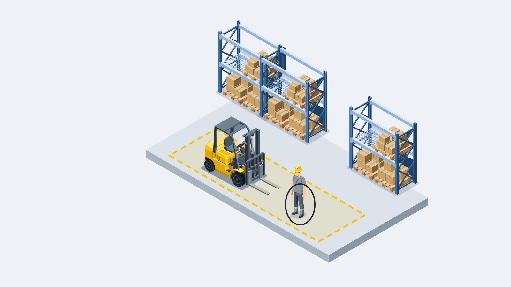
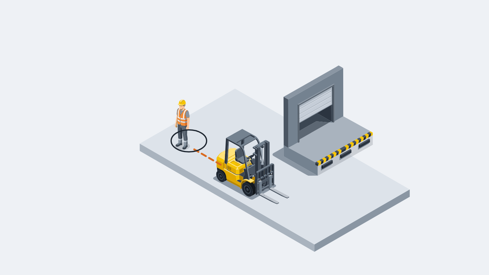
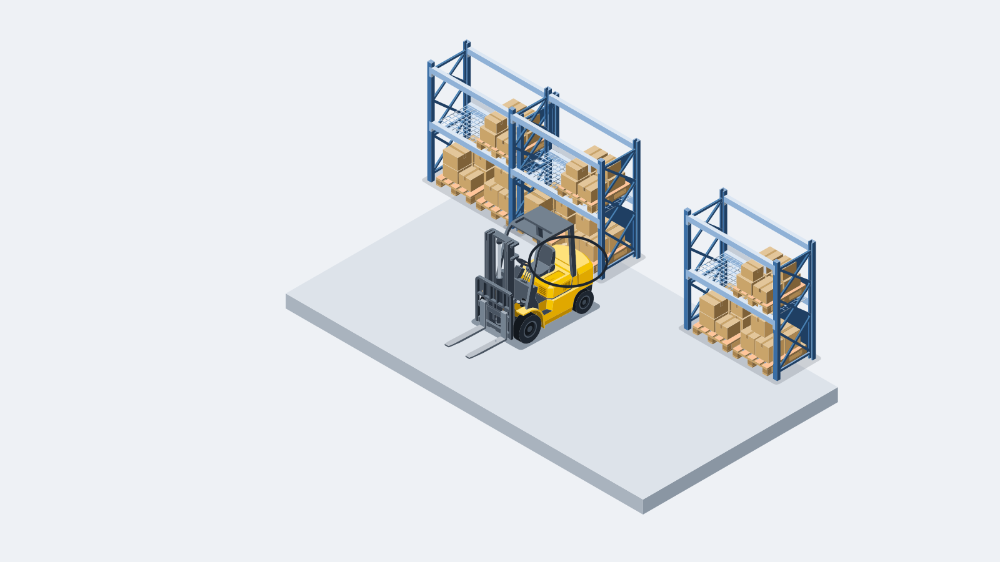
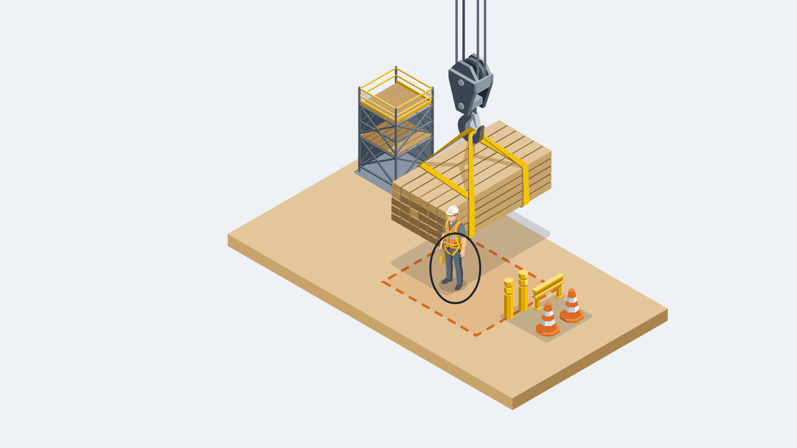
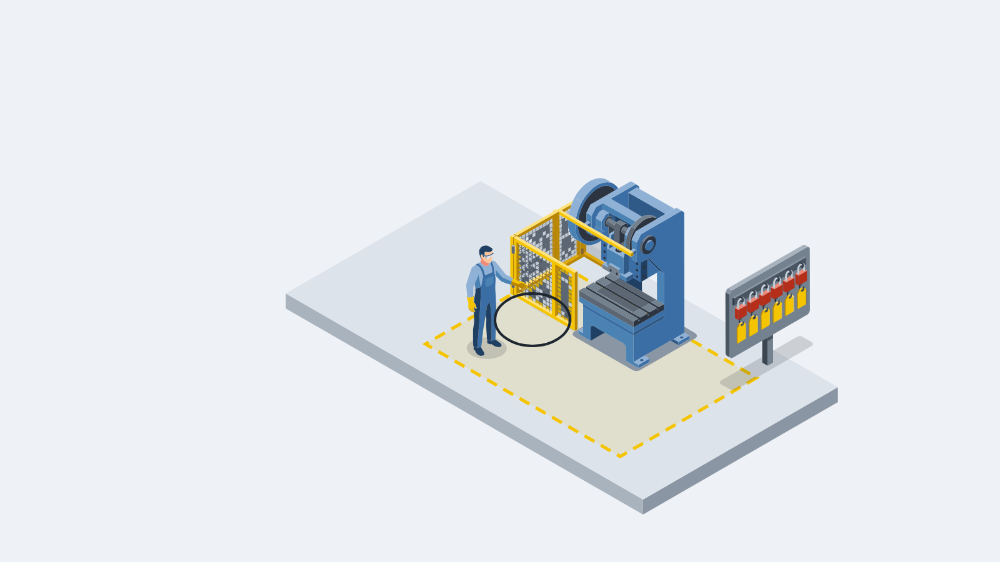
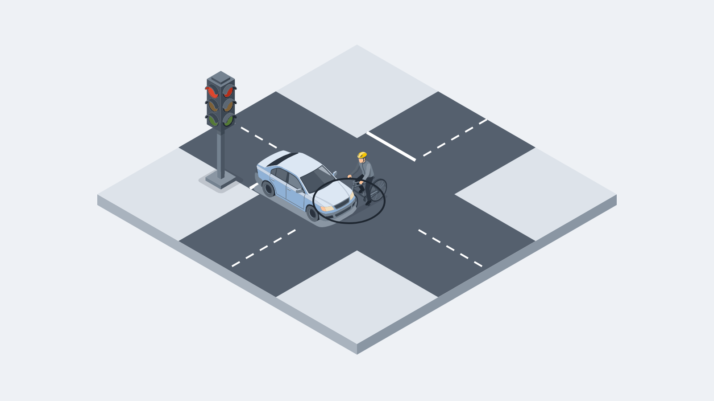
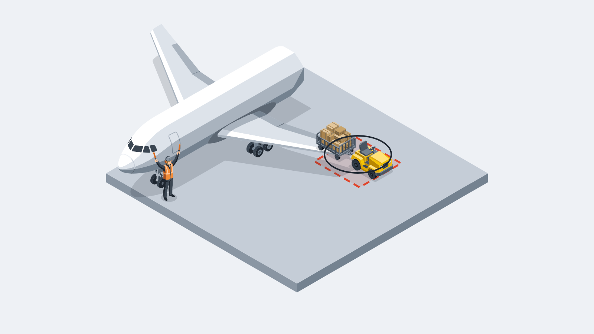

# faultline

[](LICENSE)
[](pyproject.toml)
[](packs/README.md)
[](experiments/README.md)

faultline is a rules-compliance judge for video.
Give it a rules pack and footage, and it says for each rule whether it was followed and who broke it.
Every output is a ruling: the rule, the offender and the evidence, never tips or statistics.
It covers two domains today: warehouse forklifts, under OSHA 29 CFR 1910.178 and each site's own rules, and sim-racing leagues on PitBot (pitbot.gg), my league management platform.

<table>
<tr>
<td width="50%" valign="top">

<br>
A forklift's forks reach a worker at the edge of a walkway
</td>
<td width="50%" valign="top">

<br>
The car behind runs into the car ahead on the exit of a corner
</td>
</tr>
</table>

**Contents:**
[Built during the hackathon, and what existed before](#built-during-the-hackathon-and-what-existed-before) ·
[How it works](#how-it-works) ·
[The forklift judge](#the-forklift-judge) ·
[Scenes](#scenes) ·
[What was measured](#what-was-measured) ·
[Meta models used so far](#meta-models-used-so-far) ·
[How to run](#how-to-run) ·
[Repo map](#repo-map) ·
[Licence](#licence) ·
[Provenance](#provenance)

---

## Built during the hackathon, and what existed before

### Built during the hackathon

- This repo.
- The provenance hook (`.githooks/commit-msg`), its installer, and the history check (`scripts/check_provenance.py`).
- The loader in this repo (`src/faultline/pack.py`), rewritten from a written contract during the hackathon.
- Pack metadata edited to drop dates and internal file names; no rule text changed.
- The `forklift-site-rules` pack, four rules a site sets for itself.
- The racing judge: the core every data source shares, the PitBot adapter, the `faultline` command line, and the racing prep, score and evidence-card scripts.
- The forklift judge: the video adapter (`src/faultline/adapters/video/`), the `faultline-video` and `steward` command lines, the demo in `demo/`, the span checker and the contract smoke, and their tests.
- Thirty-seven measured experiments, logged under `experiments/`: twenty-two model experiments; eleven smoke tests of the scripted pieces, six of them with no paid call, three with SAM masks or tracks and two with Spark Open rulings; three scripted experiments with no model call; and one check of the tournament's code-only grader.
  Thirteen of the thirty-seven made no metered model call: nine cost nothing at all, and four used only GPU time on Modal.
- The forklift scan route design note (`docs/forklift-scan-route.md`).
- The nine scenes in `assets/scenes/`.
- The licence files `LICENSE` and `NOTICE`, and `assets/NOTICE.md`.

<!-- tally:start -->
#### The running count

| What | Count |
|---|--:|
| Commits in this repo | 68 |
| Experiment logs published here | 37 |
| Experiment records in the working repo | 36 |
| Experiment scripts in the working repo | 215 |
| Experiment data files in the working repo | 669 |
| Design notes published here | 2 |
| Design notes in the working repo | 8 |
| Build plans in the working repo | 5 |
| Rules packs | 8 |
| Rules | 110 |
| Tests | 687 |
| Paid calls to Meta models | 4552 |
| Dollars metered on Meta models | $78.61 |

Counted by `scripts/tally.py` from this repo and from the working repo's own count, last run Thursday 29 Oct 2026, 23:43 UTC; every item is dated at or after the kickoff on 26 Oct 2026.
The meter covers the Meta Model API and Baseten; Modal GPU time is billed by the hour and the coding tools run on a subscription, so neither is in it.
The working repo holds the scripts, data and notes behind every experiment, and this repo keeps the logs, the packs and the loader, so it stays small and readable; PROVENANCE.md says what the working tooling is.
<!-- tally:end -->

### Existed before

- The rules-pack format (a folder of markdown rule files plus `pack.json`) and an earlier private loader for it.
- PitBot's Rule Library, the source of the `oval`, `road-gt` and `open-wheel` packs.
- The four OSHA `forklift-*` packs, based on OSHA 29 CFR 1910.178.
- **Metering proxy**: holds the API key and enforces spend caps.
- **Task router**: routes each call to a tier of Meta models.
- **Capability probe**: probes vision models, including a contact detector built on SAM.
- **Tournament harness**: runs many coding agents on one brief and grades them against held-out human steward decisions.
- **Corpus scraper**: gathers steward footage and comments.

These tools are private and not in this repo; [PROVENANCE.md](PROVENANCE.md) says what each one is and what changed during the hackathon.

---

## How it works

faultline is one judge, and any data source plugs in through an adapter: a sim feed, a forklift's own telemetry, or video where a site only has cameras.
The core never knows which source it is reading.

### Rules packs

A rules pack is a folder of markdown rule files plus one `pack.json`.
`pack.json` holds a `name`, a `version` and a `domain`, all non-empty strings, an optional `source`, and an optional `unique_ids_across_domain` flag.
Each rule file opens with a header between two `---` lines that gives the rule's `id` and `title`, then the rule text.
A forklift rule also says what a breach looks like on footage (`On video:`) and names its clause (`Source:`):

```markdown
---
id: travel_speed
title: Travel at a speed that allows a safe stop
---
Drive at a speed that lets the truck stop safely. Keep to the site's authorised speed limits and traffic rules.

On video: The truck cannot stop before a person, truck or object that was in view in time. The truck brakes hard, slides, or goes faster than a speed limit shown in the clip.

Source: 1910.178(n)(8), 1910.178(n)(1)
```

### The loader

[`src/faultline/pack.py`](src/faultline/pack.py) loads packs with the standard library only.
`load_pack(folder)` loads one pack, and `load_packs(root, domain=None)` loads every pack folder under a root, or one domain's.
Rule files are read in file-name order, as UTF-8 with any line endings, and each rule keeps its `Source:` clause as `source_clause`.
A broken pack stops with a `PackError` that names the file and the reason, such as a missing field, an unclosed header or a rule id used twice.
Packs flagged `unique_ids_across_domain` may not share a rule id with another flagged pack in the same domain.

### The packs shipped

| Pack | Domain | Rules | Source |
|---|---|--:|---|
| `forklift-operating-travel` | `warehouse-forklift` | 14 | OSHA 29 CFR 1910.178 |
| `forklift-loads-stacking` | `warehouse-forklift` | 7 | OSHA 29 CFR 1910.178 |
| `forklift-pedestrians-site` | `warehouse-forklift` | 10 | OSHA 29 CFR 1910.178 |
| `forklift-truck-checks-fuelling` | `warehouse-forklift` | 15 | OSHA 29 CFR 1910.178 |
| `forklift-site-rules` | `warehouse-forklift` | 4 | Site rules |
| `oval` | `sim-racing` | 20 | PitBot Rule Library |
| `road-gt` | `sim-racing` | 21 | PitBot Rule Library |
| `open-wheel` | `sim-racing` | 19 | PitBot Rule Library |

The site pack holds rules a site sets for itself, and each of its rules says so in its `Source:` line.
The sim-racing packs and the site pack carry `[placeholders]` where each league or site sets its own values.
Every forklift rule has an `On video:` line, every OSHA rule cites a 1910.178 clause, and the tests check both.

### Racing

Racing is the first adapter, [`src/faultline/adapters/pitbot/`](src/faultline/adapters/pitbot), for leagues on PitBot.
Its results are measured in the [racing pipeline log](experiments/2026-10-29-racing-pipeline/LOG.md), on 10 steward decisions from a PitBot league.

A steward's protest and the sim's own feed go in.
The protest is the driver's report and the race it is about.
The feed is the sim's replay of that race, with the broadcast stream and its measured offset.

One ruling line comes out per protest, and one per car over the incident limit.
Each line carries the rule, the offender, the window, the candidates, the facts, the frames, the model's read, the evidence and a record hash.
`faultline replay` rebuilds every line from its record, byte-identical, with the network off.

A protest is read in six steps:

1. Every car number and driver name in the protest becomes `car <sim number>`, and a lint refuses any name left in the text.
2. The steward gives the moment, as a steward reviewing a protest does; the window runs from 3 s before it to 2 s after.
3. Scripts confirm contact from the sim's own paired +4 count and close the set of cars within 8 m of a protest car.
4. The facts are blame-neutral sentences from the feed, each with its time resolution.
5. The broadcast gives 17 frames, 2 a second over 4 s either side of the moment, with names masked and every frame named by its own hash.
6. A Meta model gives its read of fault under the league's rules pack, from 8 of those frames, choosing the offender only from the closed set.
   It runs three times, and a read counts only when all three agree.

For a contact, the script never rules a breach.
The steward rules, and the model's read sits beside the evidence, never as a ruling.
The incident limit (league code 9.2) rules from the feed alone.

The demo shows the evidence pack and the steward's ruling, without the model's read.
The model's read did not pass its mark: 4 of 8 on both arms, Spark Open and Spark 1.3, against a mark of 8 of 8.
The evidence cards list each read as the model's read, with this result beside it, and never as a ruling.
Every agreed read that named a car named the right one, 4 of 4 on each arm, and the agreement gate kept every wrong single run out.

| Mark | Result | Pass mark | Verdict |
|---|---|---|---|
| Rule A, incident limit | 7 of 7 decisions found, byte-identical over two runs | 7 of 7 | pass |
| Locator | 2 of 7 windows hold the truth second ±2 s | 5 of 7 | fail |
| Closed set | the truth parties inside on 8 of 10, median size 3.5 over all 10 and 4 over the 8 located | 7 of 10, median 4 or fewer | pass |
| Model's read, offender | 4 of 8 on each arm | 8 of 8 | fail |
| Replay | byte-identical with the network blocked, on both arms | byte-identical | pass |
| Spend | $1.76 on the metering proxy | $5 | pass |

- The incident limit also found 29 cars over the limit: 8 match a ruling on record, and 21 are over the limit, no ruling on record.
  Under code 9.9 only reported incidents are ruled, and only the stewards can say why no ruling exists.
- The locator failed, so the steward gives the moment; the locator still runs and its window stays on each line.
- Around the locator's own windows, the closed set held the truth parties on 9 of 10.
- The car-behind constant names 7 of 8 offenders, because it is handed the confirmed contact second.
- On decision 18 the frames do not clearly show the contact.
  Spark 1.3 agreed on all three runs that it is not visible and named no car; one Spark Open run named car 5, and the gate kept it out.
- Spark Open returned no text on 6 of 24 runs, all on decisions 11 and 24, because its reasoning used the whole 12,000-token ceiling.

The commands run from the repo root on a league's own data:

```sh
uv run faultline racing limits --league data/racing/league.json --out runs/limits.jsonl
uv run faultline racing judge data/racing/reports.jsonl --league data/racing/league.json \
    --rules <the league's rules pack> --moments data/racing/moments.json \
    --masks data/racing/masks.json --stage rule \
    --model meta-models/muse-spark-open-1026 --arm 1 --out runs/judge.jsonl
uv run faultline replay runs/judge.jsonl --out runs/judge.replay.jsonl
uv run python scripts/racing_score.py runs/limits.jsonl runs/judge.jsonl
uv run python scripts/racing_card.py
```

`--stage` stops at `locate`, `frames` or `rule`, and `--model muse-spark-1.3 --arm 2` runs the second arm with a strict reply schema.
`scripts/racing_prep.py` builds the league file and the protests from the league's own records first.
`moments.json` holds one feed second per protest, given by the steward.
`masks.json` holds the rectangles that black out names on each stream, and the broadcast layouts whose frames are dropped.
`scripts/racing_card.py` writes one evidence card per ruling, an over-limit page per session, the honesty card for decision 18 and an index.

### Built, and still in design

In this repo today: the pack format, the loader, the eight packs, the racing judge with its PitBot adapter, their tests and the provenance tooling.
The forklift adapter is in the repo now too, as the video judge in [The forklift judge](#the-forklift-judge); the [forklift scan route](docs/forklift-scan-route.md) for long footage with no report is still in design.
The racing judge calls Spark Open and Spark 1.3 at runtime.

---

## The forklift judge

The forklift judge reads video from fixed site cameras, where a site has no other feed, so it is the `video` adapter: [`src/faultline/adapters/video/`](src/faultline/adapters/video).
A rules pack and a clip go in, and one ruling per rule comes out: the rule, the verdict, the frames and the evidence.
The verdict is `breach`, `clear` or `unable to rule`, and an unable ruling names the one fact that was not measured.
Scripts measure and decide.
Meta's models see the frames, help compile the pack and write words beside a ruling, and a model's read counts only where three runs agree.
`faultline-video replay` rebuilds every ruling from its record, with the network off, to the same bytes.

A clip is read in seven steps:

1. The clip gets its sha256 and an entry id before any model call.
2. Gates refuse what the camera cannot show: a window shorter than a second, a shot cut, a camera that moved, a camera the site has not marked, a clip with no truck in it, or a rear path out of view.
3. SAM 3.1 tracks the truck from a box on its first frame, and finds the people from text alone.
4. The floor plane comes from four points I marked by hand for each camera, and every truck and person is placed on it.
5. A fact sheet is measured on that plane: the truck's speed and which end is its forks, each person's distance from the truck, the rear cone, the hi-vis colour on the torso, a still spotter, the dock zone, and the strip in front of a rack base.
   Each speed and distance is a band from a fixed-seed ensemble of perturbed planes, not a single number.
6. The pack is compiled to predicates over a closed list of fifteen fields, with a hand route key for every rule; Spark Open's compile ships a predicate only where three runs agree.
7. A script rules each predicate against the fact sheet; a band that straddles its line is not proven either way, so the ruling is unable and names that fact.

The rule text stays as the site wrote it.
Three values the site sets and the rule text does not hold (the moving line, the strip in front of a rack base and the hi-vis share) are declared in [`src/faultline/adapters/video/data/site_values.json`](src/faultline/adapters/video/data/site_values.json), and the span checker lists them as the site's own values.

### How the judge applies the site's rules

Each of these is what the code in this tree does today.

- **Nobody in view**: when no truck is tracked in a window, a person rule (hi-vis, separation) is clear only if three person prompts each find nobody on any frame, each reply's own count of the frames it processed covers the window, no forklift box was found, the whole view is in frame and the camera held still.
  An empty reply with no frame count, or a count short of the window, never clears.
  The person track's run record is cited in the ruling where it covers the window, and is never a condition.
  The rules that need a truck stay unable to rule, naming `truck.moving`.
- **Structure contact**: a touch on racking, an upright, a guard, a column or stacked stock is a breach of the site's rule, with or without a visible consequence.
  These cameras cannot show a touch from a strip in front of a rack base, so where the truck's front holds in the strip and no consequence follows within half a second, the judge rules unable, names `contact.consequence`, and says the touch is not provable from this camera.
  The consequence is the judge's standard of evidence, not the site's rule.
- **The dock zone**: a dock zone is drawn from the trailer and dock: the trailer mouth plus two metres each side, never from where a guide stood.
  A guide inside it is recorded, and the dock-guide exemption excuses a frame only where the truck's speed into the zone is read; on a frame where the bottom edge cuts the truck, that speed is not read.
- **A reverse the frame cuts**: when the bottom edge of the frame cuts the truck's outline, its lowest point is the frame edge, not the floor, so no floor measurement proves a second of reverse.
  A spotter ruling that rests on such frames is unable to rule, naming `truck.reversing`.
- **The truck includes its forks**: points beyond the truck's body at floor height are its own forks.
- **Fixed cameras**: the judge reads fixed site cameras, because its floor plane comes from marks that assume the camera holds still.
  A camera that moved is unable to rule, and the ruling says so: the camera moved, and this judge reads fixed site cameras.
  A camera mounted on the truck is possible and is a separate mode I have not built.

### What it scored

On the 26 graded fixed-camera clips, against a key I reviewed by hand:

| Mark | Result |
|---|---|
| Breach clips found | 12 of 14 |
| False breaches on the compliant clips | 0 of 10 |
| Unable to rule | 24 of 96 rulings on the 24 clips keyed on these four rules, each naming its missing fact; the two clips keyed on the speed rule, which these marks leave out, add one unable each (structure contact, naming `contact.consequence`), so the rulings file holds 26 |
| Replay | byte-identical on Windows and in a Linux container with no network |
| Gates | 26 of 27 cropped, hidden, empty or cut-short windows handled as labelled, each refusal naming the right field; the three empty-aisle windows clear their person rules; 0 of 10 controls refused |
| Compile | 110 of 110 rules parsed, 0 invented fields, 0 bare numbers, 2 thresholds whose span does not hold its value |

The empty aisle now clears its hi-vis and separation rules, and the reverse on the upright-bump clip, seen only through a cut outline, is now unable to rule; nothing else moved.
The two breach clips not found are structure contact with no visible consequence, which the site's rule calls a breach and these cameras cannot prove.
Forklift speeds and distances on these synthetic clips are a ranking, not metres: the walkers read too slow on every camera, so no value is quoted in metres here.
The speed order holds: a faster truck reads faster.

The forklift demo, `faultline-video shift`, stitches clips into a shift and builds a dashboard: every breach shows the number that decided it, and every unable ruling names its missing fact in plain words.
`faultline-video demo` builds a one-file walk through it, and `demo/` holds that page, its twelve-line script and one still per line.
The contract smoke, `scripts/contract_smoke.py`, runs `steward judge` on an items file with no model call and checks every line.

---

## Scenes

### The forklift site rules

One scene for each rule in the `forklift-site-rules` pack.

<table>
<tr>
<td width="50%" valign="top">
pedestrian_separation</code>: a forklift's forks reach a worker at the edge of a walkway" width="100%">
<br>
<code>pedestrian_separation</code>: a forklift's forks reach a worker at the edge of a walkway
</td>
<td width="50%" valign="top">
hi_vis_in_truck_zone</code>: a worker without a vest walks where a forklift works" width="100%">
<br>
<code>hi_vis_in_truck_zone</code>: a worker without a vest walks where a forklift works
</td>
</tr>
<tr>
<td width="50%" valign="top">
spotter_when_reversing</code>: a forklift backs towards a worker nobody is watching for" width="100%">
<br>
<code>spotter_when_reversing</code>: a forklift backs towards a worker nobody is watching for
</td>
<td width="50%" valign="top">
structure_contact</code>: a forklift backs its counterweight into a rack upright" width="100%">
<br>
<code>structure_contact</code>: a forklift backs its counterweight into a rack upright
</td>
</tr>
</table>

### Other domains

A rules pack is a folder of markdown rules, so the same judge reads any written rule set.
These are four more places where written rules meet camera footage.
faultline ships no packs for them.

<table>
<tr>
<td width="50%" valign="top">

<br>
Construction, OSHA 29 CFR 1926.1425: a worker stands under a crane's load
</td>
<td width="50%" valign="top">

<br>
Factory, OSHA 29 CFR 1910.147: an operator reaches into a press with its guard open and no lockout
</td>
</tr>
<tr>
<td width="50%" valign="top">

<br>
Roads, a state traffic code: a car runs a red light into a cyclist crossing on green
</td>
<td width="50%" valign="top">

<br>
Airport ramps, the airport's ramp rules: a baggage tug drives inside the wing-tip clearance zone
</td>
</tr>
</table>

## What was measured

Before designing the steward, I measured what Meta's models can and cannot do on real league footage, with real driver reports and human steward decisions as the answer key.
The forklift side was measured on synthetic warehouse clips against a hand key, and on a rendered aisle that records its own truth.
Each experiment has one log with the question, the run, the cost, the findings and the decision; the index is [experiments/README.md](experiments/README.md).

| Experiment | Question | Headline | Cost |
|---|---|---|---|
| [Capability probe](experiments/2026-10-26-capability-probe/LOG.md) | What can Meta's models do? | 29 probes ran: 15 worked, 14 worked badly; top score 0.75 | — |
| [Steward limits](experiments/2026-10-26-steward-limits/LOG.md) | Can a video-only steward rule? | First batch 18 right, 4 wrong, 3 not scorable; second 18 right, 5 wrong, 10 not scorable | $1.998 and $5.14 |
| [Router tier 2: Spark Open](experiments/2026-10-26-router-spark-open/LOG.md) | Can Spark Open replace Spark 1.3? | 49 of 55 (89.1%) against Spark 1.3's 50 of 55 (90.9%) | About the same per call |
| [Discovery 3](experiments/2026-10-26-discovery-3/LOG.md) | Which follow-up tests change the design? | 26 of 28 tests ran; finds the moment, fails on who is who | $5.59 |
| [Router tier 1: Glimmer on Modal](experiments/2026-10-27-router-glimmer-modal/LOG.md) | Is Glimmer on Modal fast enough? | 220 prompts in 14 minutes; routed bench 92.7% (51 of 55), level with all tier 3 | $0.82 list price against $2.37 |
| [Identity from two cameras](experiments/2026-10-27-identity-two-cameras/LOG.md) | Does a second camera settle identity? | Not shown: one unconfirmed cross-camera match, no culprit named | About $0.65 of GPU time |
| [Steward panel](experiments/2026-10-27-steward-panel/LOG.md) | Does a panel beat one call? | Spark panel 3 of 5 verdicts against the single call's 2 of 5; Spark Open panel 1 of 5 | 2.4 times the single call |
| [Smoke test A: closed-set identity](experiments/2026-10-27-smoke-a-closed-set-identity/LOG.md) | Does a closed set pin identity? | Key partner held 10 of 10; 4 of 4 logged misreads snapped right | No model, no paid call |
| [Smoke test B: clock strip](experiments/2026-10-27-smoke-b-clock-strip/LOG.md) | Can template matching read the clock? | TIME and LAP digit-exact on 17 of 18 strips at 3.13 ms median a crop; offset 977.0 on one stream, refused on the other | $0 |
| [Smoke test C: contact rule](experiments/2026-10-27-smoke-c-contact-rule/LOG.md) | Is contact asserted only on contact? | Contact asserted at 27.733 s, inside the 27.6-27.9 s truth; 4 of 5 no-contact windows passed | $0.156 of SAM |
| [Smoke test D: forklift locator](experiments/2026-10-27-smoke-d-forklift-locator/LOG.md) | Can a script find forklift activity? | 28 of 28 active spans on a 421 s shift, nothing in the idle gaps, two byte-identical runs | $0 |
| [Smoke test E: hi-vis colour rule](experiments/2026-10-27-smoke-e-hi-vis/LOG.md) | Can colour alone read a vest? | Fixed camera: 0 of 9 vested read unvested, 4 of 4 unvested found; moving camera: one washed-out vest read unvested, a fail | $0 |
| [Smoke test F: reversing and spotter](experiments/2026-10-27-smoke-f-reversing-spotter/LOG.md) | Can a script read reversing and a spotter? | 2 of 3 clips met the mark; the "reversing with a spotter" clip shows forward travel | $0.04 of SAM |
| [Smoke test G: structure contact](experiments/2026-10-27-smoke-g-structure-contact/LOG.md) | Does a mask gap to a structure find contact? | Fails both readings of the mark: an image-plane gap is not contact, 3 of 5 compliant clips read "touched" | $0.146 of SAM |
| [Smoke test H: detector and one ruling](experiments/2026-10-27-smoke-h-detector-ruling/LOG.md) | Does a pinned detector count people, and does one ruling call rule right? | Detector 15 of 16; ruling mark not met: 2 of 3 compliant windows falsely breached, 2 of 3 breach windows hit the token ceiling | $0.1413 of Spark Open |
| [Self-compiling rules](experiments/2026-10-27-self-compiling-rules/LOG.md) | Can Spark Open compile a rulebook into a pack? | Short rulebooks copied exactly (86 of 86, 55 of 55); the long prose one condensed to 184 of 297 verbatim, 2 invented | $2.69 |
| [Agreement at scale](experiments/2026-10-27-agreement-at-scale/LOG.md) | How often does the pipeline agree with the steward? | 16 of 58 cleaned cases (27.6%) against a 60% mark | About $5.20 of Spark Open |
| [Glimmer at 32K, two cameras again](experiments/2026-10-27-glimmer-32k-two-cameras/LOG.md) | Does a second camera settle identity at 32K? | Fails: 1 and 2 of 3 key pairs confirmed, and a crash invented | $2.60 of GPU time, shared with Glimmer as forklift ruler |
| [Floor plane from depth, GPU ledger](experiments/2026-10-27-depth-plane-detr-ledger/LOG.md) | Can a GPU ledger replay, and can depth give the floor? | Ledger byte-identical on 47 of 47 clips; depth plane on 10 of 16 cameras, truck length in band 1 of 10 | $0.67 of GPU time |
| [Glimmer as forklift ruler and labeller](experiments/2026-10-27-glimmer-forklift-ruler/LOG.md) | Can Glimmer read vests and write the ruling? | Vest 21 of 21 with 0 false yes in both runs; as ruler 0 of 3 compliant windows clean | $2.60 of GPU time, shared with Glimmer at 32K |
| [Panel against single call, 50 cases](experiments/2026-10-27-panel-50/LOG.md) | Does the panel beat one call on 50 cases? | Panel 20 of 50, single call 18, a gap of 2 against a mark of 5 | $6.22 |
| [OCR on number crops](experiments/2026-10-27-ocr-closed-set/LOG.md) | Can OCR name the other car? | Fails twice: DETR crops 2 of 6 (1 real); SAM crops 2 of 6, plus 2 wrong from overlay digits | $0.105 of SAM |
| [Self-compiling by section](experiments/2026-10-27-self-compiling-by-section/LOG.md) | Does compiling by section stop the condensing? | 198 of 297 verbatim against a mark of 283, 2 invented | $0.33 of Spark Open |
| [Smoke test I: floor plane and speed](experiments/2026-10-27-smoke-i-floor-plane-speed/LOG.md) | Does a floor homography rank speed, and does a floor strip stop false contact? | Speeding clip first at 3.53 m/s; the strip read contact on no clip, collisions included | $0 |
| [Smoke test J: floor distance and ruling](experiments/2026-10-27-smoke-j-floor-distance-ruling/LOG.md) | Does a measured distance fix the ruling? | Near miss smallest at 0.19 m; all 3 compliant windows still breached, with no truck speed on the sheet | $0.1279 of Spark Open |
| [Smoke test K: tracker](experiments/2026-10-27-smoke-k-tracker/LOG.md) | Does the tracker drop the operator and keep pedestrians? | 0 of 13 pedestrians dropped, no id swaps, byte-identical; only 2 of 5 drivers dropped | $0 |
| [Round 4: racing ceiling](experiments/2026-10-28-round-4-racing-ceiling/LOG.md) | Which half fails on racing? | The frame input: Spark Open 27.6% and Claude Opus 39.7%, both under the 44.8% constant answer | $1.479 of SAM |
| [Round 4: forklift metre](experiments/2026-10-28-round-4-forklift-metre/LOG.md) | Can forklift values be quoted in metres? | No: walkers read two to four times slow; SAM 3.1 gave 0 of 25 identical masks; the script keeps the verdict | $2.570 |
| [Round 4: Blender twin](experiments/2026-10-28-round-4-blender-twin/LOG.md) | Where does forklift error come from? | 11 of 19 marks hold; the method's +3.9% comes from the counterweight's 0.12 m clearance | $0.3685 of SAM and $0.3011 of Modal CPU |
| [Round 4: footpoint clearance fix](experiments/2026-10-28-round-4-footpoint-clearance/LOG.md) | Does a footpoint at clearance height fix it? | All four marks pass: speed error +0.02%, contact at frame 82 against 84, the near pass silent | $0 |
| [Round 4: demo backbone](experiments/2026-10-28-round-4-demo-backbone/LOG.md) | Does the demo replay offline, and does Spark Open abstain? | Same replay hash on two platforms; abstention refused 11 of 17 unrulable windows and 4 of 10 controls | $3.1346 |
| [Round 4: Meta-model use](experiments/2026-10-28-round-4-meta-model-use/LOG.md) | Where does a Meta model do a job no script does? | Spark Open video samples 1 frame a second; SAM from text alone found the truck on 13 of 14 scorable clips and 12 of 13 people | $6.79 |
| [Round 4: abstention](experiments/2026-10-28-round-4-abstention/LOG.md) | Does any signal stop wrong passes? | No: 3 of 5 narrow wrong passes are unanimous on all 10 calls; a temperature-0 repeat flips 29.5% of verdicts | $12.67 |
| [Grader v2](experiments/2026-10-28-grader-v2/LOG.md) | Can a code-only grader rank candidates the same way every time? | Byte-identical on two grades; 7 of 16 candidates pass the gate; the top three find 3 of 14 breaches | $1.50 of grader spend |
| [League catalogue](experiments/2026-10-28-league-catalogue/LOG.md) | Can scripts align a league's streams to its replay feed? | All 11 race sessions aligned at about ±2 s; 10 of 19 on-track decisions match feed events | $0 |
| [Racing telemetry judge](experiments/2026-10-29-racing-telemetry-judge/LOG.md) | Can league rules be ruled from the feed alone? | Incident limit 7 of 7; contact referral covered 2 of 9 decisions and named 0 of 3 offenders | $0 |
| [Racing pipeline](experiments/2026-10-29-racing-pipeline/LOG.md) | Do the pieces that each worked alone make one judge? | Incident limit 7 of 7; locator 2 of 7; closed set 8 of 10; the model's read 4 of 8 on both arms against a mark of 8 of 8 | $1.76 |

**[Capability probe](experiments/2026-10-26-capability-probe/LOG.md), 26 Oct.**
What can Meta's models do on each candidate steward feature?
All 29 probes that can run have run: 15 worked, 14 worked badly.
The top score, 0.75, went to a local uncertainty signal for the router.

**[Steward limits](experiments/2026-10-26-steward-limits/LOG.md), 26 Oct.**
Given a driver's incident report and the evidence clip, can a video-only steward work out who is who, find the incident, rule correctly and show evidence a human steward can check?
The first batch scored 18 right, 4 wrong and 3 not scorable for $1.998; the second scored 18 right, 5 wrong and 10 not scorable for $5.14.

**[Router tier 2: Spark Open](experiments/2026-10-26-router-spark-open/LOG.md), 26 Oct.**
Can Muse Spark Open replace `muse-spark-1.3` as the router's tier 2 without losing answer quality?
Spark Open passed 49 of 55 (89.1%) against Spark 1.3's 50 of 55 (90.9%), at about the same cost per call.
I switched tier 2 to Spark Open, because it scored close and the steward should use more of Meta's open-weights models.

**[Discovery 3](experiments/2026-10-26-discovery-3/LOG.md), 26 Oct.**
Which of 28 follow-up tests on footage, telemetry and tools change the steward design?
26 of 28 tests ran for $5.59, and the pipeline finds the moment but fails on who is who.

**[Router tier 1: Glimmer on Modal](experiments/2026-10-27-router-glimmer-modal/LOG.md), 26 and 27 Oct.**
Can Muse Glimmer on a Modal L40S answer tier 1 at a usable speed, and which of the 220 labelled prompts can it answer?
Glimmer answered all 220 prompts from Modal in 14 minutes, where the local GPU takes about 50 s a call.
The routed bench scored 92.7% (51 of 55), level with sending everything to tier 3, at a list price of $0.82 against $2.37.

**[Identity from two cameras](experiments/2026-10-27-identity-two-cameras/LOG.md), 27 Oct.**
Does a second camera settle who is who, when Glimmer on Modal reads both streams of one incident?
Not shown: Glimmer on Modal read the position and lap boxes well enough to locate a crash, but its one cross-camera match has no answer key and it named no culprit.
The Modal app's 8,192-token context held each camera to 5 frames, and the run used about $0.65 of GPU time.
A later look at the stills found no crash in that window, so the crash it located was a guess ([Glimmer at 32K](experiments/2026-10-27-glimmer-32k-two-cameras/LOG.md)).

**[Steward panel](experiments/2026-10-27-steward-panel/LOG.md), 27 Oct.**
Does a prosecutor, defence and judge panel rule better than one steward call?
A Spark panel got 3 of 5 verdicts and 3 of 5 roles right against the single call's 2 of 5 and 1 of 5, at 2.4 times the cost; a Spark Open panel got 1 of 5.
No setup could rule right on the two clips where no frame shows the contact.

**[Smoke test A: closed-set identity](experiments/2026-10-27-smoke-a-closed-set-identity/LOG.md), 27 Oct.**
Can a closed set of cars near the camera car, from telemetry, pin the other car and correct a misread number?
The set held the key partner in 10 of 10 scorable cases, with a median of one car at the contact second, and snapped 4 of 4 logged misreads to the right number.
It ran on scripts alone, with no model and no paid call.

**[Smoke test B: clock strip](experiments/2026-10-27-smoke-b-clock-strip/LOG.md), 27 Oct.**
Can template matching read the broadcast clock strip with no model, and can the clock fix the video offset?
TIME and LAP read digit-exact on 17 of 18 strips at 3.13 ms median a crop, and a constancy filter dropped the one wrong read.
The offset came out at 977.0 on one stream; on the other the solver refused, because its two witnesses disagreed by 139 s.

**[Smoke test C: contact rule](experiments/2026-10-27-smoke-c-contact-rule/LOG.md), 27 Oct.**
Does a contact rule on SAM masks, behind a shot-cut gate, assert contact only where there was one?
The gate removed the one false contact on the broadcast clips but misses soft cuts in similar scenery, and the paid track asserted contact at 27.733 s, inside the 27.6-27.9 s truth.
4 of 5 no-contact windows passed; the failure is a chase view where a car cornering looks like a spin.

**[Smoke test D: forklift locator](experiments/2026-10-27-smoke-d-forklift-locator/LOG.md), 27 Oct.**
Can a script walk a long warehouse clip with no report and return a short list of active windows, the same way every run?
On a 421 s shift joined from 28 synthetic clips it found 28 of 28 active spans, raised nothing in the idle gaps, and two runs were byte-identical.
It finds activity, not breaches: compliant clips raise windows too.

**[Smoke test E: hi-vis colour rule](experiments/2026-10-27-smoke-e-hi-vis/LOG.md), 27 Oct.**
Can a script read a person's vest from colour alone, in three states, without ever calling a vested person unvested?
On the 16 fixed-camera clips, with a background mask and thresholds fixed before the run, 0 of 9 vested people read unvested and 4 of 4 unvested people were found.
On 19 moving-camera clips, read from the box alone, one pale vest washed out by distance and blur read unvested, which fails the mark, and no single threshold change fixes it.
Two drivers would have read unvested behind the cab frame, so the driver must be excluded before the colour test.

**[Smoke test F: reversing and spotter](experiments/2026-10-27-smoke-f-reversing-spotter/LOG.md), 27 Oct.**
Can a script read reversing travel from truck and fork-end boxes, and a spotter in the rear cone, on one fixed camera?
2 of 3 clips met the mark, on hand boxes and on SAM boxes alike, and two runs were byte-identical.
The clip labelled "reversing with a spotter" shows the truck travelling toward its mast, which is forward, so the label does not match the footage.
It cost $0.04 of SAM.

**[Smoke test G: structure contact](experiments/2026-10-27-smoke-g-structure-contact/LOG.md), 27 Oct.**
Does a SAM mask gap to a drawn structure zone, plus a visible consequence, assert contact only on the collision clips?
It fails under both readings of the mark: a mast or a far truck in front of a rack reads a 0 px gap in the image, so 3 of 5 compliant clips read "touched, no visible consequence", and with a consequence required the upright bump is missed.
Contact has to be measured on the floor plane, not as mask overlap in the image; it cost $0.146 of SAM.

**[Smoke test H: detector and one ruling](experiments/2026-10-27-smoke-h-detector-ruling/LOG.md), 27 Oct.**
Does a pinned DETR person detector count people right, and does one Spark Open call per window rule under the right rule?
The detector counted 15 of 16 clips right with the driver rule, and two runs were byte-identical.
The ruling did not meet its mark: 2 of 3 compliant windows got a false separation breach from an eyeballed distance, and 2 of 3 breach windows ran out at the 6,000-token ceiling with no ruling.
The six calls cost $0.1413 of Spark Open.

**[Self-compiling rules](experiments/2026-10-27-self-compiling-rules/LOG.md), 27 Oct.**
Can Spark Open turn a flat rulebook into a rules pack the loader accepts, without a person splitting the rules first?
Copying was exact on the two short rulebooks, 86 of 86 and 55 of 55 units with none invented.
The long prose rulebook was condensed to 184 of 297 sentences verbatim with 2 invented, and its packs still loaded.
A grader of the same model family rated 8 and 10 of its 10 rules `same`, and the code floor turned 9 of 10 on each sheet to `wrong`; the run cost $2.69.

**[Agreement at scale](experiments/2026-10-27-agreement-at-scale/LOG.md), 27 Oct.**
How often does the pipeline's ruling match the human steward's on corpus cases, and which stage is to blame when it does not?
On 58 cleaned cases it agreed on 16 (27.6%, interval 17.8% to 40.2%) against a 60% mark; the 20-case pilot got 5 of 20, cropped or not.
Contact (13) and locating (11) led the 40 graded misses, and the model ruled penalty on only 8 of its 44 rulings.
It cost about $5.20 of Spark Open by the ledger.

**[Glimmer at 32K, two cameras again](experiments/2026-10-27-glimmer-32k-two-cameras/LOG.md), 27 Oct.**
With the 8,192-token context removed, does a second camera settle who is who?
It fails its mark: the 16-frame call confirmed 1 and then 2 of the 3 key pairs, where 3 were needed in both runs, and both runs invented a crash.
The 64-image call dropped frames, the whole-stream test had no timed incident to score, and the app was rolled back to 8,192 tokens.

**[Floor plane from depth, GPU ledger](experiments/2026-10-27-depth-plane-detr-ledger/LOG.md), 27 Oct.**
Can a GPU detector give a replayable per-frame ledger, and can Depth Anything give the floor plane and scale from one frame?
The RT-DETR ledger was byte-identical on 47 of 47 clips across two fresh containers and counted people right on 15 of 16, but held a truck box in every frame on only 4 of 15.
The depth plane was accepted on 10 of 16 cameras and put the truck's length in band on 1 of 10, so the four hand floor points stay; it cost $0.67 of GPU time.

**[Glimmer as forklift ruler and labeller](experiments/2026-10-27-glimmer-forklift-ruler/LOG.md), 27 Oct.**
Does Glimmer read hi-vis vests the way the hand key does, and can it write the forklift ruling?
It read vests 21 of 21 with no false yes, in both runs of 756 calls.
As ruler it left 0 of 3 compliant windows clean and missed the structure contact Spark Open found, so Spark Open stays the ruling tier.

**[Panel against single call, 50 cases](experiments/2026-10-27-panel-50/LOG.md), 27 Oct.**
Does a prosecutor, defence and judge panel rule more often like the human steward than one call, on 50 cases?
The panel got 20 of 50 and the single call 18, a gap of 2 against a mark of 5, so the panel is dropped as a general tier.
Both sit at or under an always-"penalty" guess of 20, and the run cost $6.22.

**[OCR on number crops](experiments/2026-10-27-ocr-closed-set/LOG.md), 27 Oct.**
Does OCR on car crops, snapped to the closed set, name the key partner without naming a wrong car?
It failed twice: on DETR crops it named the partner in 2 of 6 cases, only 1 from a real read, and on SAM crops in 2 of 6, with 2 wrong answers from overlay digits.
The snap needs a guard against overlay text before it takes any OCR read; the SAM retest cost $0.105.

**[Self-compiling by section](experiments/2026-10-27-self-compiling-by-section/LOG.md), 27 Oct.**
Does compiling a long prose rulebook one section at a time stop the model condensing it?
No: the joined pack kept 198 of 297 sentences verbatim against a mark of 283, with 2 invented, and every sentence missing here was missing in the whole-rulebook run too.
The 125-sentence section copied exactly, so section length does not decide it; the ten calls cost $0.33 of Spark Open.

**[Smoke test I: floor plane and speed](experiments/2026-10-27-smoke-i-floor-plane-speed/LOG.md), 27 Oct.**
Does a hand-marked floor homography rank the speeding truck first, and does a floor strip at a structure's base stop false "touched" reads?
The speeding clip ranked first at 3.53 m/s, the compliant clips read 0.31 to 1.21 m/s, and all five marks held.
The strip read contact on no clip, the two collisions included, because the rear footpoint stays about a truck length from the rack; it ran on scripts alone.

**[Smoke test J: floor distance and ruling](experiments/2026-10-27-smoke-j-floor-distance-ruling/LOG.md), 27 Oct.**
Does a measured floor distance fix smoke H's ruling?
The near miss read the smallest distance, 0.19 m, and the model reported the measured distances correctly.
All 3 compliant windows still got a separation breach, because each has a person under 3 m and the fact sheet carries no truck speed; the six calls cost $0.1279 of Spark Open.

**[Smoke test K: tracker](experiments/2026-10-27-smoke-k-tracker/LOG.md), 27 Oct.**
Can a deterministic tracker keep one id per person and drop the truck's operator without dropping a pedestrian?
It kept 13 of 13 pedestrians with no id swaps on the labelled people, and two runs were byte-identical.
It dropped only 2 of 5 labelled drivers: DETR boxed no person in the cab for two of the others, and a poor box missed the third.

**[Round 4: racing ceiling](experiments/2026-10-28-round-4-racing-ceiling/LOG.md), 28 Oct.**
Which half fails on racing: the camera, the model or the key?
The frame input fails for every model tried: Spark Open agreed on 27.6% of the 58 and Claude Opus on 39.7%, both under the 44.8% a constant "penalty" scores, with kappa intervals that hold zero.
Opus said it could not identify the cars in 46 of 58, and the oracle test never ran, because the redacted steward texts still leaked the verdict; it cost $1.479 of SAM.

**[Round 4: forklift metre](experiments/2026-10-28-round-4-forklift-metre/LOG.md), 28 Oct.**
Can the forklift side quote its measurements in metres, and who should write the verdict?
Every walker read two to four times too slow, so 0 values may be quoted in metres, and speed works as a ranking only.
SAM 3.1 gave 0 of 25 identical masks on identical bytes, and no arm, script or model, cleared 0 false breaches, so the script keeps the verdict; it cost $2.570.

**[Round 4: Blender twin](experiments/2026-10-28-round-4-blender-twin/LOG.md), 28 Oct.**
With per-frame truth from a rendered aisle, how much forklift error comes from the method, the hand marks and perception?
11 of 19 marks hold.
The method's +3.9% speed error comes from the counterweight's 0.12 m clearance, which also puts the inferred fork tip about 0.4 m forward and breaks the contact rule on perfect inputs; it cost $0.3685 of SAM and $0.3011 of Modal CPU.

**[Round 4: footpoint clearance fix](experiments/2026-10-28-round-4-footpoint-clearance/LOG.md), 28 Oct.**
Does projecting the truck's footpoint at the counterweight's clearance height remove the bias and fix the contact rule?
All four marks pass, on truth boxes and on SAM boxes: the speed error falls from +3.9% to +0.02%, contact fires at frame 82 against a truth of 84, and the near pass stays silent.
It re-scored the twin's recorded boxes, with no paid call.

**[Round 4: demo backbone](experiments/2026-10-28-round-4-demo-backbone/LOG.md), 28 Oct.**
Can the demo replay offline to one hash, can its ledger be published, and does Spark Open say "unable to rule" when it should?
The replay gave the same hash on Windows and on an offline Modal container, in 12.6 s there, and the 7.99 MB ledger is publishable under stated conditions.
Offered "unable to rule", Spark Open refused 11 of 17 windows that cannot support a ruling and 4 of 10 controls, so a script gate decides sufficiency; it cost $3.1346.

**[Round 4: Meta-model use](experiments/2026-10-28-round-4-meta-model-use/LOG.md), 28 Oct.**
Where can Spark Open video, Spark Open rule compiling and SAM 3.1 text prompts do a job no script does?
Spark Open video samples 1 frame a second and is not the locator in either domain, and compiling the 110 rules held a closed grammar with 0 invented fields but routed only 24 of 50 forklift rules as the key does.
SAM 3.1 from text alone found the truck on 13 of 14 scorable clips and 12 of 13 pedestrians; it cost $6.79.

**[Round 4: abstention](experiments/2026-10-28-round-4-abstention/LOG.md), 28 Oct.**
Does any signal keep wrong passes at or under 1 at a usable coverage?
No: 3 of the 5 narrow wrong passes are no action on all 10 calls, so the wrong passes are confident, not noisy.
A temperature-0 repeat changed 29.5% of verdicts and two runs of one prompt disagreed on 17 of 44, so every prompt test needs three repeats an arm; it cost $12.67.

**[Grader v2](experiments/2026-10-28-grader-v2/LOG.md), 28 and 29 Oct.**
Can a code-only grader rank the tournament's forklift candidates the same way every time, with false breaches ranked first?
Two grades were byte-identical, and nine mutations of its rules each turned a test red.
Of 16 wave-1 candidates, 7 pass the gate, and the top three, with 0 false breaches, find 3 of 14 breaches; the grader spent $1.50.

**[League catalogue](experiments/2026-10-28-league-catalogue/LOG.md), 28 Oct.**
Can scripts alone align seven broadcast streams of a PitBot league to its replay feed, list the feed's events and join the steward decisions to them?
All 11 race sessions aligned at about ±2 s, across about 14.7 hours of video, and two runs of every script hashed the same.
10 of 19 on-track decisions match feed events, 5 with a contact and its stream seconds, and 8 of 9 incident-total checks are exact, so the league is a racing key no model drafted.

**[Racing telemetry judge](experiments/2026-10-29-racing-telemetry-judge/LOG.md), 29 Oct.**
Can two league rules be ruled from the companion feed alone, with no video?
The incident limit passed: all 7 incident-total decisions have a car over the limit on exactly the stated total.
Contact referral failed, covering 2 of 9 on-track decisions and naming 0 of 3 offenders, so it stays a timeline of contacts, never a ruling.

**[Racing pipeline](experiments/2026-10-29-racing-pipeline/LOG.md), 29 and 30 Oct.**
Do the pieces that each worked alone, the feed, the closed set, the frames and a Meta model's read, make one judge?
The incident limit found 7 of 7 decisions, and 21 cars are over the limit, no ruling on record.
The locator held the truth second on 2 of 7 and failed, so the steward gives the moment; around that moment the closed set held the parties on 8 of 10.
The model's read named the offender on 4 of 8 on both arms against a mark of 8 of 8, every agreed named car right, and the replay was byte-identical offline; it cost $1.76.

**Design notes:** [the forklift scan route](docs/forklift-scan-route.md) sets out, from these measurements, how scripts find candidate moments in long warehouse footage with no report and a model writes only the ruling.

### What the measurements settled

#### Identity and the moment

- **The moment is found; identity is the hard part.**
  Timing landed within 1 s on most clips, and the misses were identity: misread digits, on-screen labels trusted over the car, or a touch the camera never showed.
- **The report picks the incident.**
  Without one, a 50 s clip with five spins has no single answer, and on 18 human-steward windows with no report Spark scored 5 of 18.
- **Identity comes from the screen.**
  The replay overlay names the camera's driver and car numbers are readable, while PitBot's roster is wrong for past races, so it is a flagged fallback.
  Forklifts follow the same design: a visible fleet number plus the site's own roster, never faces.
- **A closed set of nearby cars pins the other car.**
  The cars within 8 m of the camera car, from telemetry, held the key partner 10 of 10, and snapping a read to that set corrected 4 of 4 logged misreads.
- **A second camera has proved nothing yet.**
  At 16 frames a camera Glimmer confirmed 1 and then 2 of the 3 key pairs, and both runs invented a crash the frames do not show.
- **Racing frames fail for every model tried.**
  Spark Open agreed with the human steward on 27.6% of 58 cleaned cases and Claude Opus on 39.7%, both under the 44.8% a constant "penalty" scores.
  The cars are visible but not identifiable on these review streams, and Opus said so on 46 of 58.
- **OCR does not read the other car's number yet.**
  On SAM crops it named the partner in 2 of 6 cases and a wrong car in 2, from overlay digits that snapped to the closed set.

#### Timing, contact and evidence

- **Telemetry gives the second, not the blame.**
  The models read incident counters literally, so the blame rule goes in the prompt, including "a car forced off registers no incident points".
- **Spark rules; SAM supplies frame-level evidence.**
  SAM alone misleads, because occlusion reads as touching, and broadcasts need a shot-cut gate before any SAM measure.
- **Glimmer reads the broadcast clock strip digit-exact** (7 of 7 finished reads), but locally it spends its whole token allowance thinking and runs 36 to 600 s a read on a shared 12 GB GPU.
- **The clock strip needs no model.**
  Template matching reads it 17 of 18 at about 3 ms a crop, where local Glimmer took 36 to 600 s a read.
- **The shot-cut gate earns its place, and misses soft cuts.**
  It removed the one false contact on the broadcast clips, but a cut between two shots of similar scenery scores like a steady shot.
- **A script finds the activity in forklift footage.**
  On a 421 s shift joined from 28 clips, a script locator found 28 of 28 active spans with nothing in the idle gaps, and two runs were byte-identical.
- **A gap in the image is not contact.**
  A mast or a far truck in front of a rack reads a 0 px mask gap, so 3 of 5 compliant forklift clips read "touched"; structure contact has to be measured on the floor plane.
- **The hi-vis colour rule met its mark on a fixed camera (hand boxes, one frame a clip), not on a moving one.**
  On 16 fixed-camera clips no vested person read unvested and 4 of 4 unvested people were found; on a moving camera one washed-out vest read unvested.
- **A synthetic clip's label can be wrong.**
  The clip labelled "reversing with a spotter" shows the truck travelling forward, by hand boxes, SAM boxes and block-matched motion alike.
- **The truck's footpoint sits at the counterweight's clearance height, not on the floor.**
  Projected at 0.12 m, the speed error fell from +3.9% to +0.02% and contact fired at frame 82 against a truth of 84, with the near pass silent.
- **Forklift numbers on the synthetic clips are a ranking, not metres.**
  Walkers read two to four times too slow on every camera, so no value is quoted in metres, while the speed order holds.
- **SAM 3.1 is not deterministic on identical bytes.**
  0 of 25 repeated masks matched exactly, so every replay runs from the recorded masks.
- **SAM 3.1 finds the truck and the people from text alone.**
  It held the truck on 13 of 14 scorable clips and found 12 of 13 pedestrians with no drawn box, but "pallet racking upright" returned nothing, so structures stay hand-drawn.
  A fast truck was lost after 2 s, and the 14-of-16 mark failed as written.
- **Spark Open video sees one frame a second.**
  It is not the locator in either domain: a script opens the window and owns the second.
- **A league's broadcasts align to its replay feed by script.**
  All 11 race sessions aligned at about ±2 s, which makes the sim's incident counts and the stewards' own decisions a racing key no model drafted.
- **The incident limit rules from telemetry alone; contact referral does not.**
  The feed put a car on exactly the stated total for all 7 incident-total decisions, while its contact referral covered 2 of 9 on-track decisions.

#### Models, output and cost

- **The agent shape works.**
  Spark with tools got the verdict right 6 of 6 (roles 4 of 6) and asked for telemetry first every time.
  Spark Open drove the same tools on Baseten and wrote the best evidence plans, 12 of 12, at about $0.005 a plan.
  Meta's API has no way to switch tools off, so the steward must send "tools are closed" to get a ruling.
- **Output headroom is a correctness setting.**
  At 8,000 output tokens a third of strict-schema calls reasoned to the ceiling and returned nothing; 16,000 fixed every one.
- **Minimal reasoning effort is the triage setting**: same or better rulings, 0.27 of the output, valid JSON every time.
- **Stated confidence carries no signal yet.**
  Spark got 5 of 10 rulings right and said 0.9 on a wrong call.
- **A distance rule without a measured distance gives confident false breaches.**
  Spark Open judged "about 1 m" with no scale in the frames and ruled 2 of 3 compliant forklift windows a separation breach, so the measured floor distance goes into the ruling or the rule stays out of it.
- **A measured distance is not enough for the separation rule.**
  With floor distances on the sheet, Spark Open and Glimmer still ruled all 3 compliant windows a breach, because the sheet carries no truck speed.
- **The script holds the forklift verdict.**
  No arm, the script, Spark Open or Spark 1.3, cleared 0 false breaches on the 10 compliant clips, and the models invented quantities, so the model writes evidence text only.
- **Glimmer labels vests but does not rule.**
  It read vests 21 of 21 with no false yes, and as ruler left 0 of 3 compliant windows clean, so Spark Open stays the forklift ruling tier.
- **A filename can leak the answer.**
  Spark Open scored 19 of 20 on forklift clips with the filename, which names the label, in the prompt, and 11 of 20 with an opaque case reference.
- **The router's judge checks topic, not correctness.**
  The local 7B judge passed Glimmer on 206 of 220 prompts, so label moves rest on a stricter re-judge (129 of 206 passed) and a second read of each move.
  The router with a tier-3 floor scores 76.4% with 0.0% under-route on the 55 held-out prompts, and only 5 of 55 reached tier 1: it saves money mostly through tier 2.
- **The panel is an appeal tier.**
  A Spark prosecutor, defence and judge got 3 of 5 verdicts right against the single call's 2 of 5, at 2.4 times the cost, so it runs only where the single call and the human steward disagree.
  On 50 cases it got 20 against the single call's 18, a gap of 2 where 5 were needed, so it is dropped as a general tier.
- **A compiled pack is checked unit by unit, never accepted because it loads.**
  Short rulebooks copied exactly, but a long prose rulebook kept only 184 of 297 sentences verbatim in one call and 198 when compiled by section, and its packs still loaded.
- **A closed grammar keeps compiled rules faithful to the field list, but it does not decide judgeability.**
  Spark Open invented 0 fields over 110 rules and matched the key's route on 24 of 50 forklift rules, so each pack keeps a hand route key.
- **Spark Open repeats disagree, so a prompt test needs three repeats an arm.**
  A temperature-0 repeat changed 29.5% of verdicts, and two runs of one prompt disagreed on 17 of 44.
- **Abstention cannot come from the model.**
  The wrong passes are confident: 3 of 5 were the same on all 10 calls.
  Offered "unable to rule", Spark Open refused 4 of 10 windows a human ruled on and still ruled on 6 of 17 it could not support.
- **The demo replays from its record with no network.**
  Windows and an offline container gave the same hash, with 0 cache misses and no byte sent to a model host.

---

## Meta models used so far

Built with Muse Spark Open.

| Model | Id | Served by | Measured for |
|---|---|---|---|
| Muse Spark 1.3 | `muse-spark-1.3` | Meta Model API | Rulings from frames, reports and telemetry; router tier 2 until 26 Oct; the racing judge's read, arm 2 |
| Muse Spark Open | `meta-models/muse-spark-open-1026` | Baseten | Router tier 2; evidence planning and tool use; native video; compiling rulebooks into packs; forklift rulings from a fact sheet; the racing judge's read, arm 1 |
| Muse Wonder 1.0 | `muse-wonder-1.0` | Meta Model API | Router tier 3; deeper rulings; grading compiled packs |
| Muse Glimmer | `muse-glimmer:30b` | Ollama, locally and on a Modal L40S | Router tier 1, from Modal with the local copy as fallback; reading the clock strip and hi-vis vests |
| SAM 3.1 | `sam-3.1` | Meta Model API | Masks, tracking and contact frames, from a box prompt or from text alone |
| Muse Voice Transcribe 1.0 | `muse-voice-transcribe-1.0` | Meta Model API | Transcribing race audio |
| Llama 3.2 1B | `llama3.2:1b` | Locally | Router tier 1, replaced by Glimmer on 26 Oct |
| DETR ResNet-50 | `facebook/detr-resnet-50` | Locally, pinned, and on Modal CPU | Person counts and tracks; car crops for OCR |

The racing judge calls two of these at runtime: Spark Open as arm 1 and Spark 1.3 as arm 2.
The task router sends each call to one of three tiers: Glimmer, then Spark Open, then Wonder.
A classifier trained on the labelled prompts picks the tier, and Glimmer's labels were remeasured by asking it every prompt and judging the answer.
The judge is Qwen 2.5 7B (`qwen2.5:7b`), run locally; it is not a Meta model and never answers a prompt.

Every paid call went through a metering proxy that holds the API key and enforces a spend cap, apart from two direct calls to Baseten of well under a cent.
The probe ledger, shared by the capability probe, the steward limits, Discovery 3, the steward panel and smoke test C, stood at $13.82 of its $20 cap after Discovery 3 and $16.67 after the steward panel and $16.81 after smoke test C.
It passed the cap at $20.09 during the 50-case panel test, and I let the panel arm run.
The router ledger stood at $3.3158 after the Glimmer bench, under a $10 cap in code.
From round 4 on, each experiment also held its own spend cap in code, checked before every paid call.
The racing pipeline spent $1.76 on the metering proxy against a $5 limit.
Glimmer on Modal used $2.68 of GPU time, all covered by Modal's $30 starter credits.

---

## How to run

```sh
uv sync --group dev
uv run pytest
uv run ruff check .
```

Load the packs from Python:

```python
from faultline.pack import load_packs

for pack in load_packs("packs", domain="warehouse-forklift"):
    print(pack.name, len(pack.rules))
```

Run the racing judge with the commands in [Racing](#racing).

> [!TIP]
> After cloning, run `uv run python scripts/install_hooks.py` once.

It copies `.githooks/commit-msg` into the clone's hooks folder and sets default trailer values, and it refuses if git's `core.hooksPath` is set.
The hook fills a missing `Built-With` or `Meta-Models` trailer from those defaults, stamps a missing `Built-On` with the local time, and refuses a commit with a blank trailer or no value to fill one.
Hand-written commits say so in the message with `Built-With: <name> (by hand)`.
`uv run python scripts/check_provenance.py` checks the trailers over the whole history, and `uv run python scripts/build_log.py --write` regenerates the build log.
`uv run python scripts/tally.py --write` refreshes the running count from `tally.json`.

---

## Repo map

| Path | What it holds |
|---|---|
| [`src/faultline/pack.py`](src/faultline/pack.py) | The rules-pack loader |
| [`src/faultline/`](src/faultline) | The core every data source shares: the record (`record.py`), the reply ledger (`ledger.py`), the closed set (`roster.py`), the name lint (`lint.py`), the model client (`client.py`), the frame cutter (`frames.py`), the model's read (`ruling.py`) and the `faultline` command line (`cli.py`) |
| [`src/faultline/adapters/pitbot/`](src/faultline/adapters/pitbot) | The racing adapter: the feed, its events, the protest normaliser, the locator, the facts, the incident limit and the `faultline racing` commands |
| [`src/faultline/adapters/video/`](src/faultline/adapters/video) | The forklift judge: the gates, SAM masks and tracks, the floor plane, the fact sheet, the pack compiler, the rulings, the record and replay, the shift dashboard and the demo builder; its site values, camera marks and pinned reads sit in `data/` beside the code |
| `faultline-video` | The forklift judge's command line: `judge`, `replay`, `roster`, `compile`, `scan`, `shift` (the demo shift and its dashboard), `demo` and `lifecycle` |
| `steward` | The steward contract's command line: `steward judge` writes one contract line per item |
| [`demo/`](demo) | The forklift demo: the one-file walk (`faultline-demo.html`), its twelve-line script (`SCRIPT.md`), one still per line (`STILLS/`) and the site pack it reads (`pack/`) |
| [`packs/`](packs/README.md) | The eight rules packs, and the format in [`packs/README.md`](packs/README.md) |
| [`experiments/`](experiments/README.md) | One log per measured experiment, with an index |
| [`docs/`](docs/forklift-scan-route.md) | Design notes; [`docs/forklift-scan-route.md`](docs/forklift-scan-route.md) designs the forklift route for long footage with no report |
| [`tests/`](tests) | Tests for the loader, the shipped packs, the racing judge and its adapter, the forklift judge (`tests/adapters/video/`), the public-tree sweeps, the hook, the history check, the build log, the running count and the provenance text; `tests/fixtures/` holds two small packs |
| [`scripts/`](scripts) | The hook installer, the history check, the build-log generator, the running-count renderer, and the racing prep, score and evidence-card scripts |
| [`scripts/check_spans.py`](scripts/check_spans.py) | The span checker: every compiled threshold against the pack sentence that holds its value, and the site's own values listed apart |
| [`scripts/contract_smoke.py`](scripts/contract_smoke.py) | The contract smoke: `steward judge` on an items file with the model host closed, every line checked |
| [`.githooks/commit-msg`](.githooks/commit-msg) | The provenance hook |
| [`PROVENANCE.md`](PROVENANCE.md) | What was built during the hackathon, what existed before it, and the models used |
| [`PROVENANCE_START`](PROVENANCE_START) | The first hooked commit, where the history check starts |
| [`BUILD_LOG.md`](BUILD_LOG.md) | The dated log of every commit |
| [`tally.json`](tally.json) | The private tooling's count of the work kept out of this repo, read by `scripts/tally.py` into the running count |
| [`pyproject.toml`](pyproject.toml), [`uv.lock`](uv.lock) | The project, its commands and its locked dependencies and dev tools |
| [`assets/`](assets/NOTICE.md) | The images, with their notice in [`assets/NOTICE.md`](assets/NOTICE.md) |
| [`LICENSE`](LICENSE), [`NOTICE`](NOTICE) | The Apache License 2.0 and the copyright notice |

---

## After the hackathon

The hackathon build stops on 4 November 2026.
The work does not.
This is what I build next, in the order I expect to do it, so a reader can see where the project is going and hold me to it.

### Racing truth from the sim's own replay

The racing judge reads a broadcast and a once-a-second position feed, and both are a step away from the truth.
A sim replay file is the truth: every car's position on every tick, and who touched whom, by construction.
The file itself is a closed binary, and only the sim decodes it, so the plan is to play it back inside the sim and read the live arrays through the SDK while a script chooses the camera and the car.
I have the first replay from a league in hand.
The first step is a probe that proves the per-car arrays fill during playback, and that a script can seek and switch camera.
If they do, the re-render replaces every screen read for leagues that save their replays, and the judge's racing rulings get a key that nobody drafted.

### Cleaner labels, then the model's read again

The racing corpus labels come from what the reviewer says on the recording, and the labeller counted the word "point" as a penalty.
The model's three-run read of that corpus loses to the constant answer on the labels as they stand, and beats it on the clean subset.
The replay of that read costs nothing: every reply is recorded.
So the next step is a relabel by hand, reviewed before any score is trusted, and the read scored again.
The rule does not change: a model's read ships beside a ruling only where three runs agree and beat the constant.

### The forklift metre, on a site that states its camera

The judge measured against a synthetic twin found a real error: it read the truck's lowest pixels as the floor, when they are the truck's underside.
The fix is in and guarded, and it changes nothing on a hand-marked site, because the hand marks do not give a camera.
On a site that states its camera and the truck's clearance it halves the error in speed and distance.
That is the first site I want to run it on.

### The twin, closer to a real site

The twin that renders the forklift clips with exact per-frame truth needs a human mesh with clothes instead of a mannequin, lens distortion in the camera model, more than one truck shape, and a clip where a person does not get out of the way.
Each of those is a parameter the generator draws, so each adds to the same held-out split.

### Reads the judge still refuses

A truck whose outline the frame's edge cuts cannot be read as stopped or reversing from its footpoint, so the judge says unable.
Reading its direction from the fork end instead is the next measurement to try.
The commentator scan, which finds candidate incidents in the broadcast, sits under its precision floor, and the next attempt checks every miss against the position feed for a light touch the sim never counted.
One ruling waits on a site owner, not on code: whether a touch on racking with no visible consequence is a breach when the pack's words say so.
The judge keeps saying unable until that answer is written into the pack.

### More sims, more sites

The core is domain-neutral and every data source is an adapter.
The next adapters are a second racing sim's feed and a second kind of site, so the same packs and the same judge run where the rules are written in plain words.

---

## Licence

> [!NOTE]
> The code, rules packs and documents are licensed under the [Apache License 2.0](LICENSE).
> The images in `assets/` are not: they are Copyright 2026 Brock Strehle, all rights reserved ([assets/NOTICE.md](assets/NOTICE.md)).

---

## Provenance

[PROVENANCE.md](PROVENANCE.md) says what was built during the hackathon, what existed before it, and which models were used.
[BUILD_LOG.md](BUILD_LOG.md) is the dated log of every commit, generated from git.
Every commit after the first two carries three trailers: `Built-With`, `Meta-Models` and `Built-On`.
